# REA Functional Reconstruction Benchmark

[简体中文](README.md) · **English**

Current version: **v5 · 20 original seeds · 5 release formats · 60 model runs**. Requested model: `deepseek-v4-flash`; returned model identifier: `deepseek-flash`. REA version: 6.4.0. The goal is to reconstruct the observable behavior of a specified feature from released software artifacts.

## Pipeline

```mermaid
flowchart LR
    A[Review sources and licensing] --> B[Check runtime and REA capabilities]
    B --> C[Curate seeds and feature contracts]
    C --> D[Implement targets and independent references]
    D --> E[Build clean and N/S/D perturbed releases]
    E --> F[Run private hidden tests and dependency checks]
    F --> G[Deduplicate, report diversity, and freeze with hashes]
    G --> H[Evaluate three settings under equal budget ceilings]
    H --> I[Report per-seed scores, workflow audits, and actual usage]
```

N: rename identifiers and paths. S: introduce actual module dispatch and indirect calls. D: retain unrelated code and resources. Perturbations must pass behavioral equivalence checks. The current process combines **manual curation with scripted builds and validation**; it is not yet an agent that automatically generates arbitrary applications.

[Build pipeline and usage (Chinese)](pipeline/README.md) · [Construction, acceptance, and publication scope (Chinese)](docs/pipeline.md)

## Synthesized seeds

| Release format | Count | Features |
|---|---:|---|
| Native Mach-O + dylib | 4 | MIDI lifecycle, locale catalogs, WAV editing, calendar free/busy windows |
| Android APK | 4 | Deep-link history, dynamic shortcuts, notification groups, share inbox |
| .NET assemblies | 4 | Profile inheritance, installation planning, print queues, backup retention |
| WASM + Node host | 4 | Telemetry decoding, indexed-image processing, subtitle timelines, glyph atlases |
| VS Code VSIX | 4 | Table import, notebook recovery, resource discovery, diagnostic fixes |

[All 20 seeds and their dependency chains (Chinese)](seeds/README.md) · [Machine-readable catalog](seeds/catalog.json). The suite covers 6 functional families, 80 public inputs, and 940 hidden inputs; all 60 valid semantic mutants were detected. These are original miniature applications informed by public standards and API concepts. **No tasks were mined from real upstream applications.** The previous six tasks were not reused.

## Results

| Setting | Description | Macro average | All hidden inputs pass | Runs with REA analysis | API tokens |
|---|---|---:|---:|---:|---:|
| B | Ordinary tools and behavior queries | 53.4% | 7/20 | 0/20 | 6,404,618 |
| REA optional | B + REA, used at the model's discretion | 63.5% | 10/20 | 2/20 | 6,782,705 |
| REA workflow | B + initial analysis, evidence reading, and behavior verification requirements | 85.7% | 12/20 | 20/20* | 13,566,378 |

*The workflow setting's 20/20 includes controller initialization. The model made additional successful REA calls in 12/20 runs; 7/20 passed the complete structural workflow check, and 4/20 also satisfied the manual relevance review. The primary score averages hidden-test-family accuracy within each seed, then averages across the 20 seeds. Candidates are scored even if the workflow is incomplete.

The workflow setting scores **32.3 percentage points** above B and **22.2 points** above REA optional. However, it consumes **2.00×** the optional setting's actual tokens and also changes navigation, evidence recording, and continuation/submission rules. The 95% interval for workflow minus optional, resampled by technical track, is **[−6.2, +51.9] percentage points**. This is a development-set diagnostic with one sample per seed/setting, conducted in separate batches; it does not establish an isolated, stable benefit from the REA engine.

[Full results and limitations (Chinese)](results/v5/README.md) · [Per-seed CSV](results/v5/seed-results.csv) · [Summary JSON](results/v5/summary.json) · [Actual usage](results/v5/usage.json)

## TODO

1. **Validate and improve the proxy for real applications.** The current tasks support controlled feature reconstruction from release artifacts, but simplify feature localization, shared state, and interactions between features. Their representativeness remains unvalidated. Prioritize bounded feature slices within real applications: retain the real host, interactions, and necessary dependencies while reconstructing only a specified workflow. This avoids rebuilding entire large applications. Pair a small set of real features with their proxies and compare difficulty rankings, failure types, and relative REA gains; adding files or obfuscation alone does not reproduce real application complexity.
2. **Expand the seed dataset.** Add sources, functional families, runtime formats, and dependency structures. Deduplicate by lineage and reserve new seeds that have not been used during development for future evaluation.

Public materials include build orchestration, release construction and perturbation code, seed descriptions, and results. Test code, hidden inputs/answers, reference implementations, target business logic, candidate implementations, raw traces, and software packages remain private. Full reproduction requires private inputs and validators. Earlier bilingual reports, figures, and the 12-task experiment remain in the [v0.2 archive](archive/v0.2/README.md); their results are not pooled with v5.
