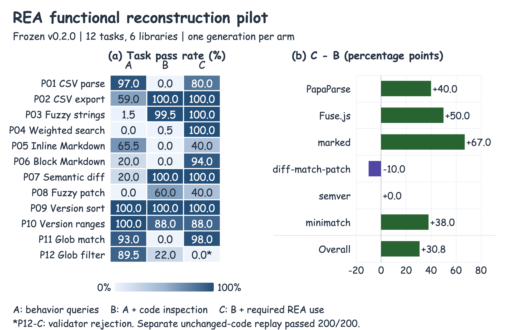

# REA 功能重建：先导实验结果

2026-10-15 · 请求模型 `deepseek-v4-flash` · REA 6.4.0 · 冻结协议 v0.2.0

6 个开源 JS 库、12 个功能任务、3 组对照，每任务每组生成一次，共 36 次有效运行。REA 辅助组较直接读代码组的平均通过率高 **30.83 个百分点**。这是描述性先导结果，尚不能证明稳定或可单独归因于 REA 的增益。

| 条件 | 软件宏平均通过率 | 严格成功任务 |
|---|---:|---:|
| A：行为查询 | 53.79% | 2/12 |
| B：A + 目标代码、搜索、基础 AST 索引 | 47.50% | 4/12 |
| C：B + 显式要求 REA 分析与语义追踪 | 78.33% | 6/12 |

**判分器修正单独报告：** P12-C 的正常 `list.__len__()` 被误拦截，冻结主表记为 0 分。仅修正规则、保持原代码与用例不变重放后，该任务 200/200 通过；对应 C 为 **86.67%**、C−B 为 **+39.17 个百分点**、严格成功 **7/12**。这没有新增模型调用，不替换主成绩，也不是独立重复。

每任务有 10 条模型可见示例和 200 条隐藏用例；输入由模板合成，答案由固定版本原库执行得到。严格成功要求总通过率 ≥95%，且每类 ≥90%。

结果受共享模板、单次生成、流程引导和程序运行失败影响；12 次 REA 语义查询均未展开关系边。服务返回模型标识为 `deepseek-flash`，无法独立确认内部权重快照。

- **[任务构建过程与 6 个实际用例](docs/task-construction-and-examples.md)**：任务来源、12 项接口、输入模板、标准答案、对照与判分、原始输入输出示例。
- [task-scores.csv](task-scores.csv)：36 次运行的冻结成绩、失败计数与用量；百分比单位。
- [summary.json](summary.json)：实验设置、聚合成绩、独立敏感性检查与数据指纹；通过率为 0–1 小数。

本仓库仅发布结果、方法说明和 6 条已有示例。测试代码、隐藏用例及完整测试集、候选实现和原始轨迹仍不公开，当前材料不足以独立复现完整评测。
