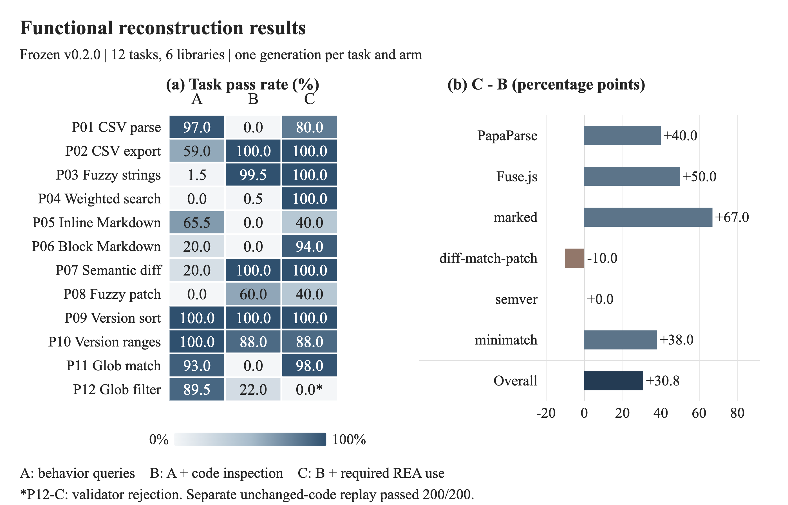

> 历史版本 v0.2（12 个 JS 功能任务），不代表当前 v5 的 20 种子结果。[返回当前版本](../../README.md)。

# REA 功能重建：先导实验结果

2026-10-15 · 请求模型 `deepseek-v4-flash` · REA 6.4.0 · 冻结协议 v0.2.0

6 个开源 JS 库、12 个功能任务、3 组对照，每任务每组生成一次，共 36 次有效运行。C 相对 B 的软件宏平均通过率高 **30.83 个百分点**；这是描述性先导结果，尚不能证明稳定或可单独归因于 REA 的增益。

**技术报告 v1.1（中英文各 9 页）：** [中文 PDF](reports/tech-report-zh.pdf) · [English PDF](reports/tech-report-en.pdf) · [中文 HTML](reports/tech-report-zh.html) · [English HTML](reports/tech-report-en.html)

| 设置 | 代表含义 | 宏平均通过率 | 严格成功 |
|---|---|---:|---:|
| A：行为查询 | 依靠任务说明、示例和原软件输入/输出查询；无目标代码或 REA | 53.79% | 2/12 |
| B：直接代码检查 | A + 压缩目标的阅读、搜索和基础函数索引；写代码前先检查 | 47.50% | 4/12 |
| C：REA 辅助检查 | B 的信息权限 + REA 证据；写代码前必须分析并做语义追踪 | 78.33% | 6/12 |

三组使用相同基础模型与预算上限；C−B 是主要工作流比较，仍混合了工具证据与显式流程引导。每任务有 10 条模型可见示例、200 条隐藏输入。严格成功要求总通过率 ≥95%，且每类 ≥90%。

图 1. 冻结协议 v0.2.0 的功能重建结果。左：12 个任务的隐藏用例通过率（%）；A 为行为查询，B 增加直接代码检查，C 再增加必需的 REA 分析与追踪。右：每个软件的两个任务平均后，计算 C−B（百分点）；Overall 为六个软件的宏平均。C 为 78.33%，B 为 47.50%，差值 +30.83 个百分点；软件层面 4 个正向、1 个持平、1 个负向。星号标记 P12-C 的判分器误拦截，其原代码独立重放为 100%，未替换图中主成绩。每条件每任务仅生成一次，图中不作统计显著性推断。

**判分器修正单独报告：** P12-C 的正常 `list.__len__()` 被误拦截。原代码、输入和执行限制不变的重放通过 200/200；相应 C 为 **86.67%**、C−B 为 **+39.17 个百分点**、严格成功 **7/12**。没有新增模型调用，不替换主表，也不是独立重复。

图由 [pyecharts](https://github.com/pyecharts/pyecharts) 2.1.0 重绘：[交互 HTML](comparison.html) · [PNG](comparison.png) · [SVG](reports/figures/comparison.svg)。两版报告均嵌入同一张图并附各自语言的完整 caption。HTML 下载后可在浏览器打开；交互图需联网加载 ECharts 5.6.0，报告 HTML 的静态图已内嵌。

- [任务构建过程与 6 个实际用例](docs/task-construction-and-examples.md)：任务来源、接口、实验设置、判分与输入输出。
- [三组实际输入 prompt](docs/experimental-prompts.md)：共同 system 消息、同一任务的 A/B/C 输入、工具权限和动态预算提醒；报告附录 B 同步收录。
- [task-scores.csv](task-scores.csv)：36 次运行的冻结成绩、失败计数与用量；百分比单位。
- [summary.json](summary.json)：设置、聚合成绩与敏感性检查；通过率为 0–1 小数。

结果受共享模板、单次生成、执行失败和流程引导影响；12 次 REA 查询均未展开关系边。服务返回模型标识为 `deepseek-flash`，无法独立确认内部权重快照。

仅公开结果、报告、图表、提示词摘录和 6 条已有示例；测试代码、隐藏用例及完整测试集、候选实现和原始轨迹仍不公开。
